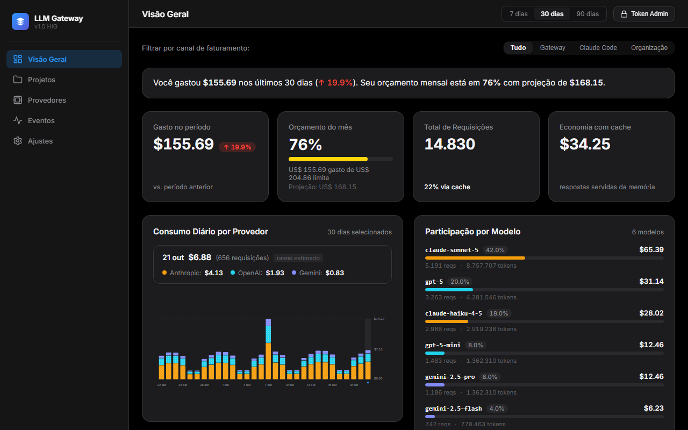
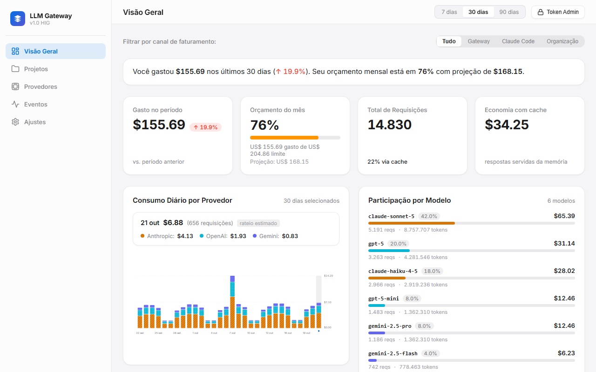

# LLM Gateway Web — Painel Executivo

[](https://github.com/Leonardoongaratto/llm-gateway-web/actions/workflows/ci.yml)
[](LICENSE)
[](https://react.dev/)
[](https://www.typescriptlang.org/)
[](#-gates-mecânicos-obrigatórios)

Interface executiva e operacional do [LLM Gateway](https://github.com/Leonardoongaratto/llm-gateway), desenvolvida sob os padrões rigorosos de design do **Apple Human Interface Guidelines (HIG)** para a web.

O painel fornece visibilidade em tempo real sobre consumo financeiro de APIs de Inteligência Artificial (OpenAI, Anthropic Claude, Google Gemini), alocação por chaves virtuais de projeto, saúde operacional de provedores, alertas de teto orçamentário e auditoria contábil.

---

## 📸 Demonstração Visual

|                           Modo Escuro (macOS HIG)                           |                           Modo Claro (macOS HIG)                            |
| :-------------------------------------------------------------------------: | :-------------------------------------------------------------------------: |
|  |  |

> _Nota: Os screenshots de referência da interface são gerados e mantidos em `docs/screenshots/` como evidência automatizada da suíte Playwright._

---

## 🛠️ Stack Tecnológica

- **Core**: React 19, TypeScript estrito, Vite.
- **Roteamento**: React Router 7 (SPA com fallback no Edge Proxy).
- **Estilização**: Vanilla CSS com tokens semânticos Apple HIG (`tokens.css`), suporte dinâmico a `prefers-color-scheme: dark`, `prefers-contrast: more` e `prefers-reduced-transparency`.
- **Gráficos e Acessibilidade**: SVG puro sem bibliotecas pesadas externas (sem Recharts/D3/visx), paleta tolerante a daltônicos com padrões táteis (listras, grade, pontilhado), navegação por teclado e leitura ARIA (`aria-live="polite"`).
- **Testes Unitários**: Vitest 5, Testing Library React, v8 coverage (cobertura $\ge 80\%$).
- **Testes E2E**: Playwright com 4 viewports e temas (Desktop 1280×800 e Mobile 360×640, Claro e Escuro), zero erros de console.

---

## 🚀 Setup e Execução Local

### Pré-requisitos

- Node.js 20+
- npm 10+
- Backend LLM Gateway (opcional para desenvolvimento local isolado via mocks, ou em execução via `lgw-dev`)

### Instalação

```bash
npm ci
npx playwright install chromium
```

### Desenvolvimento

```bash
# Iniciar o servidor Vite de desenvolvimento
npm run dev
```

### Build e Pré-visualização de Produção

```bash
# Compilar bundle otimizado de produção
npm run build

# Executar servidor preview local na porta 4174
npm run preview -- --port 4174
```

---

## 🧪 Gates Mecânicos Obrigatórios

Em conformidade com a governança do repositório (`AGENTS.md`), todos os comandos devem passar limpos com exit code 0:

| Gate                  | Comando                                                                                        | Descrição                                                                                  |
| :-------------------- | :--------------------------------------------------------------------------------------------- | :----------------------------------------------------------------------------------------- |
| **Formatação**        | `npm run format:check`                                                                         | Checagem de formatação com Prettier                                                        |
| **Lint + Tipos**      | `npm run lint; if ($LASTEXITCODE -eq 0) { npm run typecheck }`                                 | Análise estática com ESLint e checagem de tipos estrita com `tsc --noEmit`                 |
| **Testes Unitários**  | `npm test`                                                                                     | Suíte Vitest com threshold de cobertura $\ge 80\%$                                         |
| **Build de Produção** | `npm run build`                                                                                | Compilação estática de produção (`dist/`)                                                  |
| **Testes E2E**        | `npm run test:e2e`                                                                             | Suíte Playwright em 4 matrizes de viewport e tema com verificação de zero erros de console |
| **Teste em Runtime**  | `npm run build`<br>`npm run preview -- --port 4174`<br>`curl.exe -i -s http://127.0.0.1:4174/` | Validação real HTTP 200 do index e rotas SPA                                               |

---

## 🔗 Integração com o Backend

O frontend é servido diretamente pelo Edge Proxy do backend em produção através do parâmetro `-web-dir` ou variável `LGW_WEB_DIR`:

- **Repositório do Backend**: [llm-gateway](https://github.com/Leonardoongaratto/llm-gateway)
- **Subida integrada via dev server**:
  ```bash
  cd ../llm-gateway
  go run ./cmd/lgw-dev -seed-demo -web-dir ../llm-gateway-web/dist
  ```
- **Acesso integrado**: `http://127.0.0.1:8787/dashboard` com fallback SPA para `/dashboard/*`.
